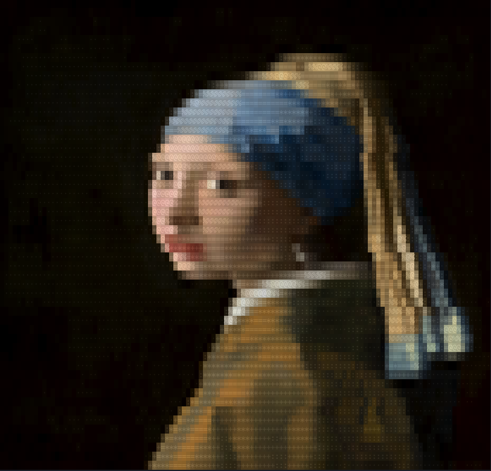

# 🎨 Pearl Earring

> *"The code is the art. The art is the code."*
> 
> vibecoded with [Kiro](https://kiro.dev) — I had the vision, AI wrote the pixels 🤝

[](https://python.org)
[](LICENSE)
[]

---

A Python script whose **source code is shaped like the silhouette** of Vermeer's *Girl with a Pearl Earring* (c. 1665) — inspired by the viral TikTok trend of ASCII code art where the code itself forms a visual.

When you **run** it, the terminal fills with a colored ASCII portrait of the girl, animated line by line.

## ✨ What makes it special

- 🖼️ **The source IS the art** — open `pearl_earring.py` and the code layout traces her silhouette: the headscarf, the face, the collar, the pearl
- 🎨 **True-color ANSI output** — skin tones, blue headscarf, golden clothing, the luminous pearl
- ⚡ **Zero dependencies** — pure Python 3.6+ standard library
- 🌊 **Animated** — fades in line by line

## 🚀 Run it

```bash
git clone https://github.com/millenchen/Pearl-Earring
cd Pearl-Earring
pip install Pillow
```

Then download the painting — save it as `1665_Girl_with_a_Pearl_Earring.jpg` in the project folder:
👉 [Download from Wikimedia Commons](https://commons.wikimedia.org/wiki/File:1665_Girl_with_a_Pearl_Earring.jpg)

```bash
# static ASCII art (shaped source code)
python3 run.py

# smooth animated wave effect
python3 animate.py
```

Requires a terminal with ANSI true-color support (macOS Terminal, iTerm2, Windows Terminal, most Linux terminals).

## 👁️ Preview



## ⚙️ How it works

The "shaped code" technique works by treating each line of source code as a pixel row:

1. **Left edge** = indentation controls where the shape starts
2. **Right edge** = line length (padded with spaces or `# ` comments) controls where it ends
3. The silhouette is carved by varying both edges across all lines
4. Real Python code — imports, constants, data, functions — fills the interior naturally

The terminal art uses ANSI 24-bit color escape codes (`\033[38;2;R;G;Bm`) to paint each character with the painting's true colors, sampled from Vermeer's original palette.

## 🎨 Credits

*Girl with a Pearl Earring* by **Johannes Vermeer**, c. 1665  
Currently held at the Mauritshuis, The Hague, Netherlands  
Public domain

Code concept inspired by the viral TikTok ASCII code art trend.

## 🤝 How this was made

Vibecoded with [Kiro](https://kiro.dev) — I brought the idea, AI brought the pixels. Pair programming with Vermeer energy.

---

*Made with ♥, Python, and a little AI magic*
